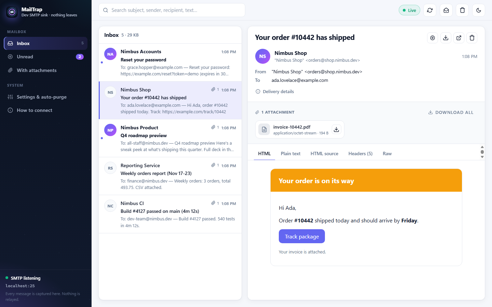

<p align="center">
  
</p>

<p align="center">
  
  
  
  
</p>

---

ThisIsATrap is a **real SMTP server that never delivers anything**. Point your apps at it during development and testing. It accepts every message, stores it locally, and shows it in a web mail client with live toast alerts. It's for internal use, so it has no sign-in.

- **Looks like a real mail server to clients.** It speaks proper SMTP (EHLO, PIPELINING, 8BITMIME, AUTH PLAIN/LOGIN) and accepts any username and password, or none.
- **Nothing ever leaves.** There is no relay code at all: messages are written to disk and that's the end of the line.
- **Web mail client.** The message list has search and unread/attachment filters. The reader has tabs for rendered HTML, plain text, HTML source, headers and the raw message. The HTML preview can be switched between **desktop, tablet (768 px) and mobile (375 px)** widths to check how a responsive email reflows.
- **Every attachment.** You can view or download each file, including inline `cid:` images, and download the whole message as `.eml`.
- **Live.** New mail appears instantly with a toast. The unread count shows in the sidebar and the browser tab title.
- **Auto-purge you control.** Set a max age, a max message count, and how often the purge runs, all from the UI. There's also a "Run purge now" button.
- **Safe rendering.** HTML mail is shown in a sandboxed iframe with scripts blocked by Content Security Policy, and attachments can never run script on the app's origin.
- Light and dark themes, a phone-friendly layout, and keyboard shortcuts.

<p align="center">
  
</p>

<details>
<summary>Light theme</summary>
<p align="center"></p>
</details>

## Contents

- [Quick start](#quick-start)
- [Deploy to IIS](#deploy-to-iis)
- [Run with Docker](#run-with-docker)
- [Connecting your apps](#connecting-your-apps)
- [Inboxes](#inboxes)
- [Auto-purge](#auto-purge)
- [Status & health](#status--health)
- [Configuration](#configuration)
- [How it works](#how-it-works)
- [HTTP API](#http-api)
- [Keyboard shortcuts](#keyboard-shortcuts)
- [Troubleshooting](#troubleshooting)

## Quick start

Requires the [.NET 10 SDK](https://dotnet.microsoft.com/download/dotnet/10.0).

```powershell
cd src/ThisIsATrap
dotnet run
```

- Web UI: http://localhost:5112
- SMTP: `localhost:2525` (Development uses 2525 so it won't collide with anything on 25)

Send some realistic test mail (HTML body, inline image, CSV and PDF attachments, Cc and Bcc):

```powershell
.\tools\Send-TestMail.ps1 -Port 2525 -Count 3
```

## Deploy to IIS

Run once from an **elevated** PowerShell on the target server:

```powershell
.\deploy\Deploy-ThisIsATrap.ps1                                             # UI on :8025, SMTP on :25
.\deploy\Deploy-ThisIsATrap.ps1 -HttpPort 80 -HostName thisisatrap.dev.local   # custom binding
.\deploy\Deploy-ThisIsATrap.ps1 -SmtpPort 2525                              # if 25 is taken
```

The script is idempotent. Re-run it to upgrade; stored mail and settings are kept. It:

1. Enables IIS, including **Application Initialization**.
2. Installs the **ASP.NET Core 10 Hosting Bundle** with winget if it's missing.
3. Publishes the app to `C:\inetpub\ThisIsATrap` and creates a `ThisIsATrap` app pool and site.
4. Keeps the SMTP listener alive. The pool is set to `AlwaysRunning`, with no idle timeout, no scheduled recycle and no overlapping recycle, and the site preloads when IIS starts. With IIS defaults, the listener would stop whenever nobody was viewing the site.
5. Grants the app pool modify rights on the data folder (`C:\inetpub\ThisIsATrapData`).
6. Opens Windows Firewall for the HTTP and SMTP ports on the Domain and Private profiles.
7. Waits until the SMTP listener reports `listening`, then prints the URLs.

| Parameter | Default | |
| --- | --- | --- |
| `-SiteName` | `ThisIsATrap` | IIS site and app pool name |
| `-SitePath` | `C:\inetpub\ThisIsATrap` | App files |
| `-DataPath` | `C:\inetpub\ThisIsATrapData` | SQLite index and `.eml` files |
| `-HttpPort` | `8025` | Web UI port |
| `-HostName` | *(none)* | Optional host header for the binding |
| `-SmtpPort` | `25` | SMTP listen port |
| `-MaxMessageSizeMb` | `50` | Larger messages are rejected |
| `-SkipFirewall` | off | Don't create firewall rules |

## Run with Docker

Runs on any Linux Docker host (or Docker Desktop). From the repo root:

```bash
docker compose up -d --build
```

- Web UI: http://localhost:8025
- SMTP: `localhost:25`
- Mail and purge settings live in the `thisisatrap-data` volume, so they survive rebuilds.

Or without Compose:

```bash
docker build -t thisisatrap .
docker run -d --name thisisatrap --restart unless-stopped \
  -p 8025:8080 -p 25:2525 \
  -e ThisIsATrap__PublicSmtpPort=25 \
  -v thisisatrap-data:/data \
  thisisatrap
```

The container runs as a non-root user, which can't bind ports below 1024, so inside the container the web UI listens on `8080` and SMTP on `2525`. Map them to whatever host ports you like. If port 25 is already taken on the host, use something like `-p 2525:2525` and set `ThisIsATrap__PublicSmtpPort=2525`. `PublicSmtpPort` only changes the port the UI tells people to connect to.

Any [configuration](#configuration) key can be set with an environment variable of the form `ThisIsATrap__<Key>`.

## Connecting your apps

| Setting | Value |
| --- | --- |
| Host | The server's name or IP |
| Port | `25` (or whatever you deployed with) |
| TLS / SSL | **Off** (no STARTTLS) |
| Authentication | None. Any username and password is also accepted. |

The **How to connect** page in the UI shows ready-to-paste snippets for the current server. For example:

```csharp
// .NET
using var smtp = new SmtpClient("trap-host", 25) { EnableSsl = false };
smtp.Send("app@example.com", "user@example.com", "Hello", "Test body");
```

```js
// Node (nodemailer)
nodemailer.createTransport({ host: "trap-host", port: 25, secure: false, ignoreTLS: true });
```

```python
# Python
smtplib.SMTP("trap-host", 25).sendmail("app@example.com", ["user@example.com"], msg.as_string())
```

Recipients that are in the SMTP envelope but not in the `To`/`Cc` headers are shown as **Bcc**, so you can check who actually got a copy.

## Inboxes

Give each app, team or environment its own inbox. The **SMTP username** decides where a message lands:

1. The client logs in with username `billing-api` (any password) → the **billing-api** inbox.
2. There's no login, but the message has an `X-Trap-Inbox: billing-api` header → the same inbox.
3. Anything else goes to **Default**.

The first message for an unknown username creates the inbox automatically. To allow only inboxes you've created yourself, set `AutoCreateInboxes` to `false`; mail for unknown names then goes to Default. Usernames are normalized into keys: `Billing API` and `billing-api` are the same inbox.

In the sidebar:
- **All inboxes** shows everything, with an inbox label on each message.
- Clicking an inbox scopes the list, search, unread count, **Mark all read** and **Delete all** to that inbox.
- The **+** button creates an inbox and shows the credentials to use.
- The gear icon on an inbox lets you rename it, set its own auto-purge rules, or delete it with its mail. Renaming keeps the key, so apps keep delivering to it.

```powershell
.\tools\Send-TestMail.ps1 -User billing-api -Password x   # routed by SMTP login
.\tools\Send-TestMail.ps1 -Inbox billing-api               # routed by header
```

## Auto-purge

Open **Settings & auto-purge** in the sidebar.

| Rule | Default | Meaning |
| --- | --- | --- |
| Enabled | on | Run the rules automatically |
| Max age (hours) | `72` | Delete messages older than this (`0` = no age limit) |
| Max messages | `1000` | Keep only the newest N (`0` = no count limit) |
| Check every (min) | `15` | How often the rules run |

These global rules apply to every inbox that doesn't have custom rules (set those from the inbox's gear icon). **Max messages** is counted per inbox. Rules are stored in the database, so they survive restarts and redeploys. Changes take effect immediately. **Run purge now** applies every inbox's rules on demand, and the trash icon in the top bar deletes everything in the current inbox.

## Status & health

**Status & health** in the sidebar, or `/#status`, shows a live dashboard that refreshes every 5 seconds:
- **Overall health** and each check: SMTP listener, database, and storage (writable, free disk space).
- **SMTP:** messages received and rejected since start, and when the last message arrived.
- **Storage:** message count and size, database size, and a disk usage bar.
- **Auto-purge:** the current rules, and when the purge last ran and runs next.
- **Application:** version, uptime, hosting (IIS, Docker or Kestrel), OS, runtime and memory.

A dot next to the menu item turns amber when something is degraded and red when something is unhealthy.

The same information is available to monitoring tools:

| Endpoint | Use it for |
| --- | --- |
| `/healthz` | **Liveness** (is the process up?). It returns `200 Healthy` without touching any dependency. |
| `/readyz` | **Readiness** (can it trap mail?). It returns a JSON report: `200` when Healthy or Degraded, `503` when SMTP isn't listening, the database fails, or the data folder isn't writable. Storage reports **Degraded** below 512 MB free. |
| `/api/status` | Everything shown on the status page, as JSON. |

Where they're used:
- **Docker:** the image has a `HEALTHCHECK` that runs `dotnet ThisIsATrap.dll --health-check`, which probes `/readyz`. `docker ps` shows `healthy` or `unhealthy`.
- **IIS:** Application Initialization warms the site up through `/healthz`. The deploy script waits for `/readyz` and prints any check that isn't healthy.

## Configuration

Static settings live in `appsettings.json` under `ThisIsATrap`. The deploy script writes the server-specific values.

```json
"ThisIsATrap": {
  "SmtpPort": 25,
  "ServerName": "thisisatrap.local",
  "MaxMessageSizeMb": 50,
  "DataPath": "App_Data"
}
```

| Key | Description |
| --- | --- |
| `SmtpPort` | SMTP listen port (all interfaces) |
| `AutoCreateInboxes` | `true`: an unknown SMTP username creates an inbox. `false`: such mail goes to Default |
| `PublicSmtpPort` | Optional. The port shown in the UI when clients reach SMTP on a different port than it listens on, for example behind a Docker port mapping |
| `ServerName` | Name announced in the SMTP greeting |
| `MaxMessageSizeMb` | Size limit advertised via `SIZE` and enforced |
| `DataPath` | Folder for `thisisatrap.db` and `messages/*.eml`. Relative paths resolve against the app folder. |

## How it works

```
 your app ──SMTP──▶ SmtpListenerService ──▶ messages/<id>.eml  +  thisisatrap.db (index)
                          │
                          └──▶ EventHub ──SSE──▶ browser (toast + list update)

 browser ◀──HTTP── minimal API ◀── MimeKit parses the .eml on demand
                          ▲
            PurgeService ─┘ (timer + "run now")
```

- **One process.** An ASP.NET Core (.NET 10) app hosted in-process by IIS. The SMTP server ([SmtpServer](https://github.com/cosullivan/SmtpServer)) runs as a hosted background service inside it. If the port is briefly busy during an IIS recycle, it retries.
- **Storage.** Each message is saved byte-for-byte as an `.eml` file, which is the source of truth. A small SQLite table indexes sender, recipients, subject, preview, size and read state for fast listing and search.
- **Parsing.** [MimeKit](https://github.com/jstedfast/MimeKit) parses the stored `.eml` when a message is opened. Bodies, attachments and inline images are streamed from it.
- **Live updates.** Server-Sent Events (`/api/events`) push `message`, `deleted` and `purged` events. The browser reconnects automatically.
- **UI.** Static HTML, CSS and vanilla JS in `wwwroot/`, with no build step. Styling follows the Keyport design system.

| Path | |
| --- | --- |
| `src/ThisIsATrap/Program.cs` | HTTP API and SSE endpoint |
| `src/ThisIsATrap/SmtpListenerService.cs` | SMTP server and message store |
| `src/ThisIsATrap/MailStore.cs` | SQLite index, `.eml` files, purge queries |
| `src/ThisIsATrap/MessageParser.cs` | MIME parsing, attachments, HTML preparation |
| `src/ThisIsATrap/PurgeService.cs` | Scheduled auto-purge |
| `src/ThisIsATrap/wwwroot/` | Web client |
| `deploy/Deploy-ThisIsATrap.ps1` | IIS install and upgrade |
| `Dockerfile`, `docker-compose.yml` | Container build and run |
| `tools/Send-TestMail.ps1` | Test mail sender (raw SMTP, optional AUTH) |

## HTTP API

Everything the UI does is available over plain HTTP, which is handy for automated tests that need to check an email was sent.

| Method | Path | |
| --- | --- | --- |
| `GET` | `/api/messages?q=&unread=&attachments=&inbox=&skip=&take=` | List and search (newest first), optionally in one inbox |
| `GET` | `/api/messages/{id}` | Full detail: headers, text, HTML, attachments |
| `GET` | `/api/messages/{id}/html` | Rendered HTML body |
| `GET` | `/api/messages/{id}/raw[?download=true]` | Raw source / `.eml` download |
| `GET` | `/api/messages/{id}/attachments/{index}[?download=true]` | Attachment content |
| `POST` | `/api/messages/{id}/read?read=true\|false` | Mark read or unread |
| `POST` | `/api/messages/read-all[?inbox=]` | Mark everything read (in one inbox) |
| `DELETE` | `/api/messages/{id}` | Delete one |
| `DELETE` | `/api/messages[?inbox=]` | Delete all (in one inbox) |
| `GET` | `/api/inboxes` | Inboxes with message and unread counts |
| `POST` | `/api/inboxes` | Create an inbox: `{ "name": "Billing API" }` |
| `GET` / `PUT` | `/api/inboxes/{slug}` | Read, or rename and set custom purge rules: `{ "name", "purge": {...} or null }` |
| `DELETE` | `/api/inboxes/{slug}` | Delete an inbox and its mail (not Default) |
| `GET` | `/api/settings` | Purge rules, SMTP status, storage stats |
| `PUT` | `/api/settings/purge` | Update purge rules |
| `POST` | `/api/purge` | Run purge now |
| `GET` | `/api/events` | Server-Sent Events stream |
| `GET` | `/api/status` | Everything on the status page: health, SMTP counters, storage, disk, purge, version, uptime |
| `GET` | `/healthz` | Liveness: `200 Healthy` while the process serves HTTP |
| `GET` | `/readyz` | Readiness: `200` when SMTP is listening, the database answers and the data folder is writable; `503` otherwise |

```powershell
# e.g. assert an integration test sent a password-reset email
$mail = Invoke-RestMethod "http://trap-host:8025/api/messages?q=reset"
$mail.items[0].subject   # "Reset your password"
```

## Keyboard shortcuts

| Key | Action |
| --- | --- |
| `j` / `↓` | Next message |
| `k` / `↑` | Previous message |
| `Del` or `#` | Delete message |
| `/` | Focus search |
| `Esc` | Close dialog |

## Troubleshooting

| Symptom | Check |
| --- | --- |
| Sidebar says *SMTP error: …* | Another process holds the port (often the IIS 6 `SMTPSVC` service). Stop it, or redeploy with `-SmtpPort 2525`. |
| Other machines can't connect | The firewall rules cover the Domain and Private profiles only. If the server's network is **Public**, run `Set-NetConnectionProfile -NetworkCategory Private` or `Set-NetFirewallRule -DisplayName "ThisIsATrap SMTP","ThisIsATrap Web" -Profile Any`. |
| Site returns 500.19 / 500.31 | The ASP.NET Core 10 Hosting Bundle is missing. Install it and run `iisreset`. |
| Startup errors | Windows Event Log → Application, source *IIS AspNetCore Module V2*. Or set `stdoutLogEnabled="true"` in `C:\inetpub\ThisIsATrap\web.config`. |
| Mail stops arriving after a while | Make sure the `ThisIsATrap` app pool is `AlwaysRunning` with idle timeout `0`. The deploy script sets this. |
