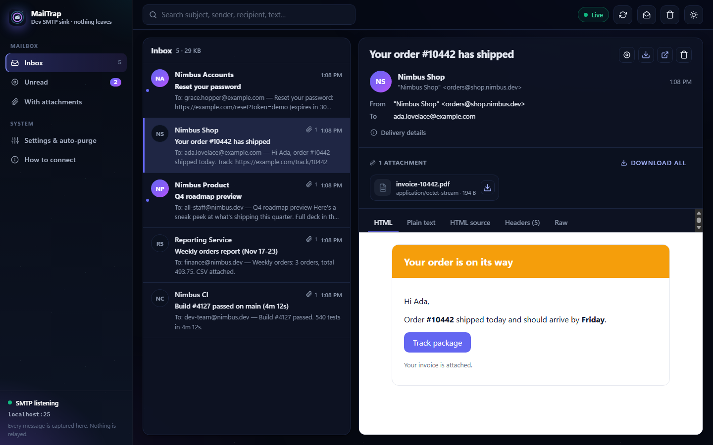

<p align="center">
  
</p>

<p align="center">
  
  
  
</p>

---

MailTrap is a **real SMTP server that never delivers anything**. Point your apps at it during development and testing. It accepts every message, stores it locally, and shows it in a web mail client with live toast alerts. It's for internal use, so it has no sign-in.

- **Looks like a real mail server to clients.** It speaks proper SMTP (EHLO, PIPELINING, 8BITMIME, AUTH PLAIN/LOGIN) and accepts any username and password, or none.
- **Nothing ever leaves.** There is no relay code at all: messages are written to disk and that's the end of the line.
- **Web mail client.** The message list has search and unread/attachment filters. The reader has tabs for rendered HTML, plain text, HTML source, headers and the raw message.
- **Every attachment.** You can view or download each file, including inline `cid:` images, and download the whole message as `.eml`.
- **Live.** New mail appears instantly with a toast. The unread count shows in the sidebar and the browser tab title.
- **Auto-purge you control.** Set a max age, a max message count, and how often the purge runs, all from the UI. There's also a "Run purge now" button.
- **Safe rendering.** HTML mail is shown in a sandboxed iframe with scripts blocked by Content Security Policy, and attachments can never run script on the app's origin.
- Light and dark themes, a phone-friendly layout, and keyboard shortcuts.

<p align="center">
  
</p>

<details>
<summary>Light theme</summary>
<p align="center"></p>
</details>

## Contents

- [Quick start](#quick-start)
- [Deploy to IIS](#deploy-to-iis)
- [Connecting your apps](#connecting-your-apps)
- [Auto-purge](#auto-purge)
- [Configuration](#configuration)
- [How it works](#how-it-works)
- [HTTP API](#http-api)
- [Keyboard shortcuts](#keyboard-shortcuts)
- [Troubleshooting](#troubleshooting)

## Quick start

Requires the [.NET 10 SDK](https://dotnet.microsoft.com/download/dotnet/10.0).

```powershell
cd src/MailTrap
dotnet run
```

- Web UI: http://localhost:5112
- SMTP: `localhost:2525` (Development uses 2525 so it won't collide with anything on 25)

Send some realistic test mail (HTML body, inline image, CSV and PDF attachments, Cc and Bcc):

```powershell
.\tools\Send-TestMail.ps1 -Port 2525 -Count 3
```

## Deploy to IIS

Run once from an **elevated** PowerShell on the target server:

```powershell
.\deploy\Deploy-MailTrap.ps1                                             # UI on :8025, SMTP on :25
.\deploy\Deploy-MailTrap.ps1 -HttpPort 80 -HostName mailtrap.dev.local   # custom binding
.\deploy\Deploy-MailTrap.ps1 -SmtpPort 2525                              # if 25 is taken
```

The script is idempotent. Re-run it to upgrade; stored mail and settings are kept. It:

1. Enables IIS, including **Application Initialization**.
2. Installs the **ASP.NET Core 10 Hosting Bundle** with winget if it's missing.
3. Publishes the app to `C:\inetpub\MailTrap` and creates a `MailTrap` app pool and site.
4. Keeps the SMTP listener alive. The pool is set to `AlwaysRunning`, with no idle timeout, no scheduled recycle and no overlapping recycle, and the site preloads when IIS starts. With IIS defaults, the listener would stop whenever nobody was viewing the site.
5. Grants the app pool modify rights on the data folder (`C:\inetpub\MailTrapData`).
6. Opens Windows Firewall for the HTTP and SMTP ports on the Domain and Private profiles.
7. Waits until the SMTP listener reports `listening`, then prints the URLs.

| Parameter | Default | |
| --- | --- | --- |
| `-SiteName` | `MailTrap` | IIS site and app pool name |
| `-SitePath` | `C:\inetpub\MailTrap` | App files |
| `-DataPath` | `C:\inetpub\MailTrapData` | SQLite index and `.eml` files |
| `-HttpPort` | `8025` | Web UI port |
| `-HostName` | *(none)* | Optional host header for the binding |
| `-SmtpPort` | `25` | SMTP listen port |
| `-MaxMessageSizeMb` | `50` | Larger messages are rejected |
| `-SkipFirewall` | off | Don't create firewall rules |

## Connecting your apps

| Setting | Value |
| --- | --- |
| Host | The server's name or IP |
| Port | `25` (or whatever you deployed with) |
| TLS / SSL | **Off** (no STARTTLS) |
| Authentication | None. Any username and password is also accepted. |

The **How to connect** page in the UI shows ready-to-paste snippets for the current server. For example:

```csharp
// .NET
using var smtp = new SmtpClient("mailtrap-host", 25) { EnableSsl = false };
smtp.Send("app@example.com", "user@example.com", "Hello", "Test body");
```

```js
// Node (nodemailer)
nodemailer.createTransport({ host: "mailtrap-host", port: 25, secure: false, ignoreTLS: true });
```

```python
# Python
smtplib.SMTP("mailtrap-host", 25).sendmail("app@example.com", ["user@example.com"], msg.as_string())
```

Recipients that are in the SMTP envelope but not in the `To`/`Cc` headers are shown as **Bcc**, so you can check who actually got a copy.

## Auto-purge

Open **Settings & auto-purge** in the sidebar.

| Rule | Default | Meaning |
| --- | --- | --- |
| Enabled | on | Run the rules automatically |
| Max age (hours) | `72` | Delete messages older than this (`0` = no age limit) |
| Max messages | `1000` | Keep only the newest N (`0` = no count limit) |
| Check every (min) | `15` | How often the rules run |

Rules are stored in the database, so they survive restarts and redeploys. Changes take effect immediately. **Run purge now** applies the rules on demand, and the trash icon in the top bar deletes everything.

## Configuration

Static settings live in `appsettings.json` under `MailTrap`. The deploy script writes the server-specific values.

```json
"MailTrap": {
  "SmtpPort": 25,
  "ServerName": "mailtrap.local",
  "MaxMessageSizeMb": 50,
  "DataPath": "App_Data"
}
```

| Key | Description |
| --- | --- |
| `SmtpPort` | SMTP listen port (all interfaces) |
| `ServerName` | Name announced in the SMTP greeting |
| `MaxMessageSizeMb` | Size limit advertised via `SIZE` and enforced |
| `DataPath` | Folder for `mailtrap.db` and `messages/*.eml`. Relative paths resolve against the app folder. |

## How it works

```
 your app ──SMTP──▶ SmtpListenerService ──▶ messages/<id>.eml  +  mailtrap.db (index)
                          │
                          └──▶ EventHub ──SSE──▶ browser (toast + list update)

 browser ◀──HTTP── minimal API ◀── MimeKit parses the .eml on demand
                          ▲
            PurgeService ─┘ (timer + "run now")
```

- **One process.** An ASP.NET Core (.NET 10) app hosted in-process by IIS. The SMTP server ([SmtpServer](https://github.com/cosullivan/SmtpServer)) runs as a hosted background service inside it. If the port is briefly busy during an IIS recycle, it retries.
- **Storage.** Each message is saved byte-for-byte as an `.eml` file, which is the source of truth. A small SQLite table indexes sender, recipients, subject, preview, size and read state for fast listing and search.
- **Parsing.** [MimeKit](https://github.com/jstedfast/MimeKit) parses the stored `.eml` when a message is opened. Bodies, attachments and inline images are streamed from it.
- **Live updates.** Server-Sent Events (`/api/events`) push `message`, `deleted` and `purged` events. The browser reconnects automatically.
- **UI.** Static HTML, CSS and vanilla JS in `wwwroot/`, with no build step. Styling follows the Keyport design system.

| Path | |
| --- | --- |
| `src/MailTrap/Program.cs` | HTTP API and SSE endpoint |
| `src/MailTrap/SmtpListenerService.cs` | SMTP server and message store |
| `src/MailTrap/MailStore.cs` | SQLite index, `.eml` files, purge queries |
| `src/MailTrap/MessageParser.cs` | MIME parsing, attachments, HTML preparation |
| `src/MailTrap/PurgeService.cs` | Scheduled auto-purge |
| `src/MailTrap/wwwroot/` | Web client |
| `deploy/Deploy-MailTrap.ps1` | IIS install and upgrade |
| `tools/Send-TestMail.ps1` | Test mail sender (raw SMTP, optional AUTH) |

## HTTP API

Everything the UI does is available over plain HTTP, which is handy for automated tests that need to check an email was sent.

| Method | Path | |
| --- | --- | --- |
| `GET` | `/api/messages?q=&unread=&attachments=&skip=&take=` | List and search (newest first) |
| `GET` | `/api/messages/{id}` | Full detail: headers, text, HTML, attachments |
| `GET` | `/api/messages/{id}/html` | Rendered HTML body |
| `GET` | `/api/messages/{id}/raw[?download=true]` | Raw source / `.eml` download |
| `GET` | `/api/messages/{id}/attachments/{index}[?download=true]` | Attachment content |
| `POST` | `/api/messages/{id}/read?read=true\|false` | Mark read or unread |
| `POST` | `/api/messages/read-all` | Mark everything read |
| `DELETE` | `/api/messages/{id}` | Delete one |
| `DELETE` | `/api/messages` | Delete all |
| `GET` | `/api/settings` | Purge rules, SMTP status, storage stats |
| `PUT` | `/api/settings/purge` | Update purge rules |
| `POST` | `/api/purge` | Run purge now |
| `GET` | `/api/events` | Server-Sent Events stream |

```powershell
# e.g. assert an integration test sent a password-reset email
$mail = Invoke-RestMethod "http://mailtrap-host:8025/api/messages?q=reset"
$mail.items[0].subject   # "Reset your password"
```

## Keyboard shortcuts

| Key | Action |
| --- | --- |
| `j` / `↓` | Next message |
| `k` / `↑` | Previous message |
| `Del` or `#` | Delete message |
| `/` | Focus search |
| `Esc` | Close dialog |

## Troubleshooting

| Symptom | Check |
| --- | --- |
| Sidebar says *SMTP error: …* | Another process holds the port (often the IIS 6 `SMTPSVC` service). Stop it, or redeploy with `-SmtpPort 2525`. |
| Other machines can't connect | The firewall rules cover the Domain and Private profiles only. If the server's network is **Public**, run `Set-NetConnectionProfile -NetworkCategory Private` or `Set-NetFirewallRule -DisplayName "MailTrap SMTP","MailTrap Web" -Profile Any`. |
| Site returns 500.19 / 500.31 | The ASP.NET Core 10 Hosting Bundle is missing. Install it and run `iisreset`. |
| Startup errors | Windows Event Log → Application, source *IIS AspNetCore Module V2*. Or set `stdoutLogEnabled="true"` in `C:\inetpub\MailTrap\web.config`. |
| Mail stops arriving after a while | Make sure the `MailTrap` app pool is `AlwaysRunning` with idle timeout `0`. The deploy script sets this. |
